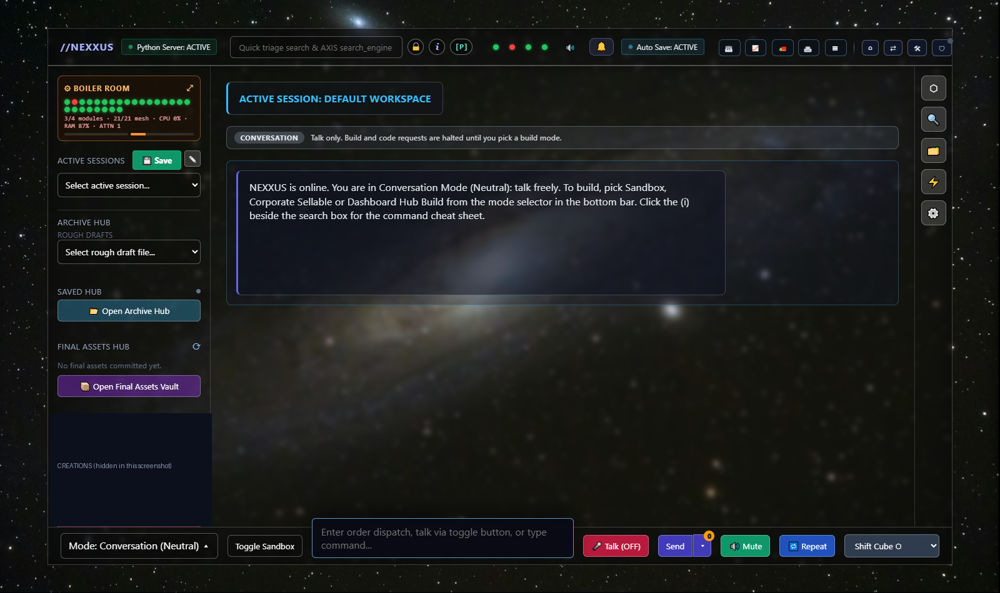

# NEXXUS

> **One operator. Twenty-one engines. No framework to hide behind.**

<!-- top-block -->
<table>
<tr>
<td width="55%" valign="top">

<br><br>
<b>What you are getting.</b> NEXXUS is an AI control room that runs on your own computer. You get a dashboard and 21 small background engines that watch each other, check what they run, and report
plainly when something is wrong. Your data stays on your machine. It is in <b>Public Beta</b>: it works, and it comes with an honest list of what is not finished yet.
</td>
<td width="45%" valign="top">
<h3>Download</h3>
<p><a href="https://github.com/jamalemccarthy3-dev/axis-bridge/releases/latest"><b>Download NEXXUS for Windows (Public Beta)</b></a></p>
<p><sub>Windows 10 or 11, Python 3.14, about 8 GB of RAM. Free for learning and non-commercial use.</sub></p>
<h4>What it does to your device</h4>
<ul>
<li>Runs a local web server on your computer, reachable only from that computer by default.</li>
<li>Starts 21 small background programs (roughly 350 MB of memory in total).</li>
<li>Writes its files inside its own folder only, including a private secret and admin token it creates for you on first run. They are never uploaded.</li>
<li>Installs the Python packages listed in <code>requirements.txt</code>. A virtual environment keeps them separate from the rest of your system.</li>
<li>Sends nothing out by default: no tracking and no accounts. It only downloads the signed update feed if you set an address for it.</li>
</ul>
<h4>Where it runs</h4>
<table>
<tr><td><b>Windows 10/11</b></td><td>Full app. Download above.</td></tr>
<tr><td><b>iPhone, iPad, Android</b></td><td>Installs as an app icon (Add to Home Screen) that opens your own NEXXUS. See below.</td></tr>
<tr><td><b>macOS, Linux</b></td><td>Not tested yet. The code is Python, but the launchers are Windows-only for now.</td></tr>
</table>
<h4>On your phone</h4>
<p>NEXXUS itself runs on your computer, so the phone app is a window onto it. Install Tailscale (a free private network) on the computer and the phone, turn phone access on, open the address NEXXUS shows in your phone's browser,
then tap Share, then Add to Home Screen (on Android: the browser menu, then Add to Home screen). You get a NEXXUS icon that opens full screen. Phone access is off until you turn it on.</p>
<p><sub>Tell us what works, what is slow and what breaks: <a href="https://github.com/jamalemccarthy3-dev/axis-bridge/issues">open an issue</a>.</sub></p>
</td>
</tr>
</table>

A **local-first, single-machine, multi-engine AI orchestration platform**. No SaaS, no cloud dependency: a governing core (NEXXUS), a bridge every component connects
through, a set of standalone engines, a dashboard, and a guardian (the axis gate) that decides what may run and what may pass.

NEXXUS is the governing layer of the system: it keeps the engine registry, runs the build and quality-control loop, holds the governance rules and speaks and reports
through the dashboard. Its autonomy is **bounded**: anything that adds capability, runs outside the sandbox or changes trusted files needs the owner's explicit approval.

> This repository is the **framework and its documentation**. The proprietary engine wiring and utility source stay private; `PRIVATE_MODULES.md` lists the names
> of what exists without publishing how it works. See `ARCHITECTURE.md` for the specification.

**Jump to:** [Quick start](#running-it) · [How it is built](#design-in-four-lines) · [Architecture](#architecture-in-one-page) · [Honest limits](#honest-limits) · [The audit](AUDIT.md) · [Why this exists](#why-this-exists)


*The dashboard on a live system: the Boiler Room shows the 21-engine mesh at a glance. (A panel of personal creations is hidden in this screenshot.)*

## Design in four lines

1. **A headless mesh of 21 nodes.** They run independently in the background: relaying instructions, persisting their own state, ingesting data. Each signs a heartbeat about every 10 s with its own derived key, and each answers `health`, `ping`, `message` and `instruct`. A node that dies does not stop the others.
2. **The dashboard is a command and aggregation center**, not 21 widgets: telemetry, the rolled-up engine cluster, perimeter controls (Hard Lock, Quarantine, bulk release with a tamper-evident record) and the owner's overrides.
3. **Deterministic routing, verified at the boundary.** No model decides who gets a message. Every packet is HMAC-signed, fresh, single-use and checked against the engine it claims to be (`axis_gate`).
4. **Claims need raw evidence.** Health checks measure real dependencies, a failure is reported as a failure, and tests run on temp folders and leave nothing behind.

```
  operator ──> dashboard (telemetry · cluster rollup · perimeter) ──> hub (python_server.py, port 8000)
                                                                          │  signed, stateless calls
                         ┌──────────── 21 headless engines (heartbeat · health · ping · message) ────────────┐
                         └── axis_gate: signed manifests · replay floor · per-engine keys · decision log ────┘
```

**How it was tested:** an adversarial architectural review, with the findings, fixes, measurements and the things still *not* proven, is in [AUDIT.md](AUDIT.md). The measurements behind it are in
[ARCHITECTURE_AUDIT.md](ARCHITECTURE_AUDIT.md), and the definition of done is [QUALITY_CHECKLIST.md](QUALITY_CHECKLIST.md).

## Running it

0. Windows 10/11 and Python 3.14. Install the core dependencies once: `pip install -r requirements.txt` (Flask, requests, NumPy, Pillow, psutil, PyYAML, cryptography). Extras such as scraping, narration and the heavy ML packages are in `requirements-optional.txt`. For chat, install [Ollama](https://ollama.com) separately; without it the dashboard still runs and says plainly that the local model is not available.
1. Double-click `START_NEXXUS.bat`. On a fresh copy it first runs `setup_nexxus.py`, which creates your own random governance secret (`nexxus_env.bat`) and admin token (`nexxus_admin.bat`). Both stay on your machine and are git-ignored; setup never overwrites an existing file and never prints a value. It starts the server, the engines and a watchdog, and never starts duplicates.
2. Open `http://localhost:8000/`.
3. To use the admin actions, click the padlock beside the search box and enter the admin token.
4. `restart_nexxus.bat` clears a stuck port; `stop_all_engines.bat` stops everything.

## Checking it

* `python verify_all.py`: every test suite (engines, bus, gate, dashboard, C engines).
* `python engine_checklist.py --all`: the nine-point definition of done for every engine, with dated raw output in `logs\`.
* `GET /api/dashboards/audit`: dashboard orphans plus the `engine_cluster` rollup (dead processes, unreferenced folders).
* `python placeholder_scan.py`: finds stub code (the target is zero findings).
* `python -m axis_gate verify`, run from `axis-ui-interface/project-X`: signed files still match their manifests.
* `ENGINE_STATUS.md` lists each engine and what is honestly verified about it.

## Architecture in one page

| Layer | What it does |
|---|---|
| **Server / control plane** (`python_server.py`) | The one HTTP surface: dashboard, chat, jobs, mesh endpoints, tool and key routes, gate telemetry. |
| **Mesh and governance** (`mesh_bridge.py`, `nexxus_governance.py`) | Engine registry and signed heartbeats; shared-secret signing between NEXXUS and the engines. |
| **Orchestrator bus** (`orchestrator_bus.py`, see `ORCHESTRATOR_BUS.md`) | Signed order envelopes with fixed states (`ORDERED > ACKED > BUILT > QC_PASSED > ACCEPTED`), independent QC (the reviewer is never the builder), only NEXXUS accepts, hash-chained ledger. |
| **axis gate** (`axis_gate`) | Signed manifests, packet verification, drift watch, single-use tickets, decision log. |
| **Engines** (`silo_vault/axis-*`) | 21 standalone engines (Python, C, JavaScript). Each reports an honest health check; "operational" means its own tests pass. |
| **Dashboard** (`silo_vault/render/`) | The UI, served locally; its 3D library is bundled. A refresh restores your screen (conversation, notes, cube face, open drawer). |
| **Boiler Room** (Diagnostic mode) | A live left-hand monitor of every engine, the bridge and the infrastructure, with drill-down per engine, and a conversation locked to the system. See `BOILER_ROOM.md`. |
| **Link mode** (AXIS LINK) | The backend window: a Transmission log of everything moving through the machine, click-to-inspect route playback, plain-English or terminal view, a hypothesis desk, and a two-slot input queue. See `AXIS_LINK.md`. |
| **Control dock and Perimeter** | Top-right dock: LINK, the Build Mode silo (expandable to full screen), PERIMETER (the axis gate with the Triad Protocol node board and Hard Lock / Quarantine overrides, breach flash and notification) and HOME. See `PERIMETER.md`. |
| **Explicit naming and the commercial watch** | Everything generated is named for what it is (no `Untitled`, no random-token drops) and tagged on creation; files you list in `commercial_watch.json` get a read-only pulse check and are never written to, run or integrated. See `NAMING_AND_WATCH.md`. |
| **Intake pipeline** | Outside code is inspected, self-healed with logged corrections, cleared by the axis gate (or blocked outright) and a private, respectful note for the original author is prepared but never sent. See `INTAKE_PIPELINE.md`. |
| **Engine Build mode** | NEXXUS writes new modular engines (standalone or linked), staged for your approval. See `ENGINE_BUILD_MODE.md`. |
| **Tool intake** | Scout, stage (never executed), brief, **owner approval**, then a signed vault entry and a sandbox. |
| **Module gateway** | Hostname routing for external modules such as picthis (3D, animation and sound). |

Two keys exist and are kept apart: the **governance secret** (shared by the server and the engines) and the **admin token** (typed into the dashboard for Probe,
Promote and Release; only the server launchers load it). Neither is ever committed.

## Honest limits

Local-first means one computer, not a cluster. Motion in picthis is authored, not AI-generated, and models built without a photo are stylised. Tool intake and
anything that changes trusted files need the owner. See `ENGINE_STATUS.md`, `PLACEHOLDERS.md` and each engine's notes for the detail.

## Milestone

On 2026-10-10 the owner reported NEXXUS coming up on the live dashboard, speaking, running risk briefings, and holding the governance loop (the checks below are the
automated side of that: `python verify_all.py` runs every suite and ends with `ALL GREEN` when everything passes).

## Why this exists

### The shift

I stopped building on top of other people's frameworks. A pre-packaged stack gives you speed on day one and a ceiling on day ninety: the structure is theirs, the failure modes are theirs, and when it
breaks you are reading someone else's code to find out why. A monolith has the opposite problem. Everything is yours, and everything is tangled together, so one bad change takes the whole thing down.

NEXXUS is the third option. It is built as one operator working with a small crew of AI collaborators (credited below, for what each did), where the operator sets the architecture and makes every
design decision, and the collaborators build, test and tighten inside rules I wrote. The autonomy is bounded on purpose: anything that adds capability, runs outside the sandbox or changes a trusted
file waits for my explicit approval. It is a one-person development model that still has review, tests and a paper trail.

### The architecture

Twenty-one standalone engines run as a headless background mesh: data pipelines, validators, builders, a media and 3D pipeline, a vault container, a diagnostics engine, and more. They are independent
processes. Each signs its own heartbeat with its own derived key, answers a real health check, and keeps running if its neighbour dies. They synchronise through one hub with signed, stateless calls and a
deterministic router, so no model ever decides who talks to whom.

Around the mesh sit the layers that make it trustworthy:

- **axis gate**: signed manifests, replay protection, single-use tickets and drift detection. Inbound files and builds stay staged until I sign them off myself.
- **Validation**: a nine-point definition of done that every engine is run against, with dated raw output instead of "it works".
- **UI factories**: dashboards and engine front-ends are generated and nested, so nothing is left orphaned.
- **A local-to-mobile bridge** over Tailscale, so the dashboard can be reached from a phone without opening a port to the internet. The bridge is built and locked down (admin token, no cross-site calls);
  the real phone test over mobile data is still on my list, and I will not call it done until it passes.

The dashboard is the command centre, not a wall of 21 widgets: telemetry, the engine cluster, perimeter controls (Hard Lock, Quarantine) and my overrides.

### The standard

A repository can be a folder of code, or it can be a workbench. I treat this one as the second. That means:

- **Evidence beats assertion.** A claim ships with a test, a measurement or a log. When something is not proven, the docs say so (see [AUDIT.md](AUDIT.md), including its list of open items).
- **Real data only.** No sample rows, mock results or placeholder code behind a button that looks finished.
- **Fail loudly and safely.** A broken dependency reports `ok: false` in plain words; a bad signature is refused and quarantined, never executed.
- **Tests leave nothing behind.** They run on temp folders and prove it with before-and-after snapshots.
- **Honest credit.** Humans and AI are named for what each actually did.

## Special thanks: GitHub, the bridge

NEXXUS is a local-first system. It lives on one computer, behind loopback, with its own keys and its own rules. That is the point of it, and it is also the problem: a sandbox on a single
machine is a world with no door. **GitHub is the bridge.** It is how this work crossed from a folder on a disk to something with a history, a public face and people on the other side.

Without that bridge, none of the rest could have crossed over. The version history that lets every change be reviewed and rolled back, the releases that put a Windows build in a tester's hands, the
issues, discussions and reactions that carry reviews and builder logs back in: all of it runs on rails GitHub provides, free to a one-person build. They did not just host the files. They made the
difference between code that exists and a system that is alive.

The bridge carries the whole story, in both directions:

- **The architecture** goes across as signed, reviewable commits. The engines, the axis gate, the orchestrator bus and the dashboard each have a trail that anyone can read, which is what lets the
  claims in this README be checked instead of trusted.
- **The AI partners** (Gemini and Claude, credited below for what each actually did) work through the same repository, at the operator's direction. Every change they make lands as a diff the
  operator can read, question and reject.
- **The operator** keeps the last word. The approval gates in NEXXUS (nothing new is trusted, run or published without the owner) have a mirror on the bridge: nothing goes out until it is committed,
  pushed and released on purpose.
- **The community** comes back across it: testers open issues, write reviews, up-vote what matters and post builder logs, so what happens in the sandbox is shaped by people outside it.

To everyone at GitHub who built and maintains the platform, and to the open-source community that fills it: thank you. This build stands on
what you made possible.

## Credits

NEXXUS was built by **many hands**, human and AI, and each is credited for what it actually did.

* **The owner** (jamalemccarthy3-dev): vision, architecture, every design decision, and the direction of the whole build. NEXXUS exists because of this person's intent.
* **Gemini** (Google): co-builder in the early design and construction of the platform alongside the owner.
* **Claude** (Anthropic): engineering collaborator who stepped in during the heavy backend bottlenecks to finish and tighten the core code: repairing and testing the
  engines, replacing placeholder code with working implementations, making health checks honest, the orchestrator-bus tests, real encryption in the C messenger, the
  dashboard fixes (drawer lock, screen restore) and the picthis 3D / animation / sound pipeline. Claude works at the owner's direction, in the owner's repository.
* **NEXXUS** itself: the governing layer. It runs the governance loop, the quality gate and the briefings, within the limits the owner set.
* *(Add any other tool that pulled weight on this build here, with one line on what it did.)*

### Built on

Babylon.js (Apache-2.0, bundled), Flask, Scrapy, NumPy, Pillow, imageio-ffmpeg and ffmpeg, Zig's C compiler (used to compile-check the C engines),
the InstantMesh model (TencentARC) for photo-to-3D in picthis, and Windows' built-in speech engine for offline narration. Third-party notices for the bundled 3D library are in `axis-ui-interface/project-X/silo_vault/render/vendor/THIRD_PARTY.md`.

## Community: reviews, ratings and builder logs

NEXXUS is in Public Beta and your experience shapes it. Everything below happens on this repository's page, in public, under your own GitHub account.

<table>
<tr>
<td width="50%" valign="top">
<h4>Rate and review</h4>
<p>Give your experience 1 to 5 stars, say what worked and what broke.</p>
<p><a href="https://github.com/jamalemccarthy3-dev/axis-bridge/issues/new?template=review-and-rating.yml"><b>Write a review</b></a></p>
<p><a href="https://github.com/jamalemccarthy3-dev/axis-bridge/issues?q=is%3Aissue+label%3Areview+sort%3Areactions-%2B1-desc">Read the reviews, most up-voted first</a></p>
<p><sub>Add a thumbs-up (👍) to any review that helps you. The most helpful ones rise to the top.</sub></p>
</td>
<td width="50%" valign="top">
<h4>Beta builder log</h4>
<p>Document your journey: what you are building, where you are, what you created, and mark your final progression when you finish the beta.</p>
<p><a href="https://github.com/jamalemccarthy3-dev/axis-bridge/issues/new?template=builder-log.yml"><b>Start your builder log</b></a></p>
<p><a href="https://github.com/jamalemccarthy3-dev/axis-bridge/issues?q=is%3Aissue+label%3Abuilder-log">See what other builders made</a></p>
<p><sub>Edit your entry as you progress. Builders who tick the box may be featured here.</sub></p>
</td>
</tr>
</table>

**Discuss:** questions, ideas and help from other testers are in [Discussions](https://github.com/jamalemccarthy3-dev/axis-bridge/discussions). **Something broke?** [Report a bug](https://github.com/jamalemccarthy3-dev/axis-bridge/issues/new?template=bug-report.yml).

**What happens to your feedback.** The maintainer reads it, and ratings, builder logs, up-votes and bug reports are copied into the project's own system logs (`feedback_sync.py`) to guide updates. Only what you choose to post
on GitHub is used. NEXXUS on your computer sends nothing about you, so please keep keys, passwords and private paths out of anything you post.
